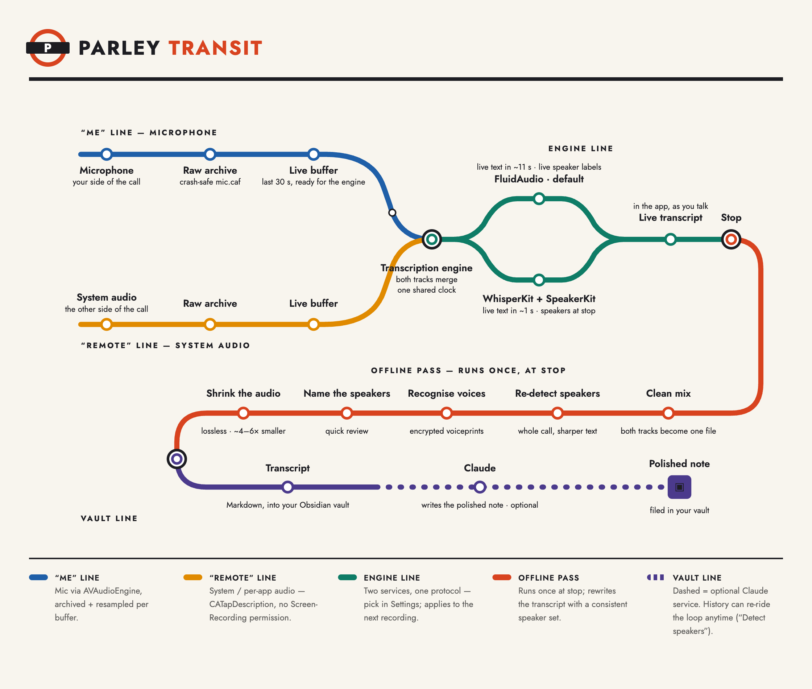

# Parley

A native macOS app that records your **microphone** and **system / per-app audio** as
two separate tracks, transcribes the call on-device, works out who said what, and files
a speaker-labelled Markdown transcript into your Obsidian vault. Optionally it then runs
the `claude` CLI to turn that transcript into a polished meeting note.

Recording the two sides separately is the point: the far side of a call never reaches
your mic cleanly, so single-stream recorders miss half the conversation. Parley keeps a
crash-safe archive of both tracks, and it can notice a call starting, begin recording on
its own, and suggest a title and attendees for the meeting.

## How it works

[](docs/architecture.html)

> The map reads left to right: the **"Me"** and **"Remote"** lines (mic + system audio,
> captured separately) interchange into the **engine line**, the red **offline pass**
> loop runs once at stop, and everything terminates on the **vault line** in Obsidian.
> Open [`docs/architecture.html`](docs/architecture.html) locally for the animated,
> interactive version.

While you record, each track is archived to disk and a 16 kHz copy feeds the live
engine. Segment times are anchored to one shared clock, so the two tracks can't drift
apart over a long meeting. When you stop, an offline pass re-checks the whole recording:
it rebuilds a clean mix, re-detects speakers across the full call, matches voices
against saved voiceprints, asks you to name anyone new, and losslessly shrinks the audio
archives (~4–6× smaller).

## Transcription

Parley transcribes with FluidAudio
([FluidInference/FluidAudio](https://github.com/FluidInference/FluidAudio),
Apache-2.0, from `0.15.6`). It mixes the microphone and system tracks into one
16 kHz stream.

English live sessions use Parakeet Unified. Other languages use Nemotron for the
live stream and Parakeet v3 for the offline pass. Batch mode records audio only
and transcribes after the call. English batch sessions use Parakeet Unified.
Other languages use Parakeet v3.

When you stop a live recording, an optional full-recording pass rewrites the
transcript. Speaker turns come from FluidAudio diarization. Saved voiceprints
use the WeSpeaker embedding model.

Models download on first use to
`~/Library/Application Support/FluidAudio/Models/`. Settings shows download
progress.

> **Voiceprints are biometric data.** Each one is encrypted at rest (AES-GCM, key in
> your Keychain) and tagged with the embedding model that produced it, so prints from
> different models never cross-match. Embeddings don't survive a model upgrade, so short
> enrollment clips are kept alongside each voiceprint — the **People** tab can
> re-enroll a FluidAudio voiceprint from the kept clip without re-recording anyone.
> Two thresholds, two jobs: the diarization threshold groups voices *within* one
> recording; the identification threshold matches a voice to a saved person *across*
> recordings. Both default to 0.6 and live in Settings → Transcription.

## Requirements

- macOS 14.4+ (Core Audio process taps), Apple Silicon recommended
- [XcodeGen](https://github.com/yonaskolb/XcodeGen) (`brew install xcodegen`)
- Xcode 15.4+
- The `claude` CLI, only if you turn on note generation

## Build & run

```bash
xcodegen generate          # regenerate Parley.xcodeproj from project.yml
open Parley.xcodeproj      # then run (⌘R)
# — or —
xcodebuild build -project Parley.xcodeproj -scheme Parley \
  -destination 'platform=macOS,arch=arm64'
```

> `Parley.xcodeproj` is **generated** and git-ignored. Make project-setting changes in
> `project.yml`, never in the Xcode UI — they're overwritten on the next
> `xcodegen generate`.

### Local release (`tools/localrelease.sh`)

For the build you actually use day to day, run the helper script instead of a raw
`xcodebuild`:

```bash
tools/localrelease.sh            # build Release, install to /Applications
tools/localrelease.sh --open     # …and launch it afterwards
```

It regenerates the project, builds the `Parley` scheme in Release, and replaces
`/Applications/Parley.app` (gracefully quitting and relaunching a running copy).

The script exists because of **signing**. It mints (once) and reuses a self-signed
certificate, **`Parley Local Codesign`**, so every build carries the same identity.
macOS keys three things on that identity:

- **TCC permissions** — mic, system-audio capture, folder access
- **keychain grants**
- **the Neural Engine cache** — the minutes-long `Specializing…` step on first model load

Xcode's fallback is *ad-hoc* signing, whose code hash changes on every build — macOS
treats each rebuild as a brand-new app, re-prompts for every permission, and re-runs the
model specialization. With the stable cert you grant permissions once and keep them.

> The cert is **local only** — not notarized, so the build runs on this Mac and nowhere
> else. Renaming the app deliberately mints a fresh cert (the bundle id changes with
> it). Public distribution still needs the archive → export → notarize → staple flow.

### Permissions

The app shows a main window plus a menu-bar companion. First launch prompts for
**Microphone**; the first recording prompts for **Audio Recording** (system audio).
There's no API to request that second one up front — macOS shows it when the first
process tap is created.

> Parley ships **non-sandboxed**: process taps, spawning `claude`, and writing into your
> vault are all incompatible with the App Sandbox. Entitlements live in
> `Parley/App/Parley.entitlements`.

## Settings

Seven tabs: **General**, **Transcription**, **Notes**, **Summary**,
**Detection**, **Storage**, and **Vault**. The ones you'll touch first:

- **Transcription** — pick the engine, its models, and the two speaker thresholds.
- **People** (main window) — manage saved voiceprints: rebuild, delete, and
  encrypted export / import for backup and transfer.
- **Notes** — the `claude` binary path, model, and prompt template (`{{file}}`,
  `{{destination}}`, `{{attendees}}` are substituted at run time).
- **Detection** — let Parley start and stop recording by itself when it sees a call.

## Verifying it works (manual — needs a GUI session)

1. **Capture** — record while playing audio and speaking, then stop. The session folder
   under `~/Library/Application Support/Parley/Recordings/` should contain `mic.caf` and
   `system.caf`.
2. **Live transcript** — text appears in the popover as you talk.
3. **Vault write** — a `YYYY-MM-DD-HHMM - <title>.md` lands in
   `<vault>/Parley/Unprocessed/`.
4. **Claude** — enable auto-run, stop a recording, and confirm the polished note appears
   at the filing destination, with the transcript moved to `Processed/`.
