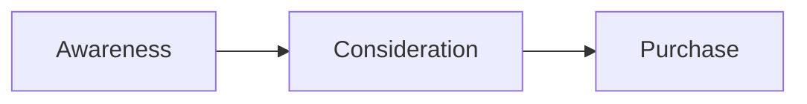

# Note Attachments — Vision & Diagram Follow-on

Stage B/C from the note-attachments design. **v1** shipped storage + caption-based
prompt injection; **Stage B/C are now implemented** behind Settings → Summary → Attachments.

## Stage B — Vision (implemented)

### Goal

Let vision-capable backends *see* whiteboard screenshots during summarization, not just
read captions.

### Settings

`attachmentUnderstanding: off | captionsOnly | vision`

- `off` — attachments stored only; not mentioned in prompts
- `captionsOnly` — **default**; `ATTACHMENTS:` block in `SummaryPromptBuilder`
- `vision` — runs a Cursor agent vision pre-pass; injects `ATTACHMENT VISION:` into writer
  and checker prompts

`attachmentVisionBackend` — Cursor agent backend used for the vision pass (default Composer 2.5).

### Architecture

1. **`AttachmentVisionRunner`** — Cursor agent in **plan mode**, vault as workspace, reads
   image files at absolute paths.
2. **`AttachmentVisionService`** — caches digest at
   `<vault>/Parley/.staging/<transcript-stem>.attachments-vision.md` with an attachment
   fingerprint; invalidates when attachments change.
3. **`SummaryService`** — classic and v2 pipelines call `digest()` before the writer when
   `attachmentUnderstanding == .vision`.
4. **`SummaryPromptBuilder`** — injects `ATTACHMENT VISION:` before `TRANSCRIPT:`.
5. **`SummaryCheckerPromptBuilder`** — receives the same digest so the checker does not
   strip grounded diagram content.

Vision failures are non-fatal: summarization continues with captions only.

### Provider matrix

| Backend | Vision pass | Notes |
|---------|-------------|-------|
| Cursor agent (Composer / Grok) | **Supported** | Primary path via `makeVisionProcess` |
| Claude CLI | Not yet | Text `-p` only; would need multimodal API |
| Grok summary CLI | Not yet | Separate vision subprocess |
| Local Qwen | Not yet | Needs vision-capable MLX model |

## Storage layout

Attachments live in a **shared** vault folder:

```text
<vault>/Parley/Attachments/<meeting-id>/whiteboard.png
```

Filed notes link with relative paths (`../../Parley/Attachments/...`). Files are not
copied beside each note.

## Stage C — Diagram extraction (implemented)

Stage C post-processes the vision digest into a filed-ready `## Diagrams` section:

1. **`AttachmentDiagramBuilder`** — matches each `###` subheading to an attachment by filename,
   appends an Obsidian `` embed under the description/mermaid block.
2. **`AttachmentVisionService.mergeDiagrams`** — replaces any existing `## Diagrams` section and
   inserts the enriched block **before** `## Attachments` when that section is already present.
3. **Pipeline auto-merge** — classic and v2 summarization call `mergeVisionDiagrams` after the
   writer (and checker for v2), so diagrams land in the staged draft without a manual describe step.
4. **Relative paths** — embed paths use `SummaryService.prospectiveNoteURL` (filed note path when
   known, else the destination folder + title) so links resolve in Obsidian after filing.

### Output shape

```markdown
## Diagrams

### Whiteboard — funnel stages
Short prose description of what the image shows.




```

The vision pass outputs `## Diagrams` (descriptions + optional mermaid). The writer may
incorporate or refine this section; `composeNote` keeps raw image embeds in `## Attachments`.

### UX

- **Settings → Attachments → Vision** — enables automatic pre-pass on summarize.
- **"Describe attachments"** in `SummaryMarkupReviewView` and History (when a staged summary
  exists) — runs vision only, merges `## Diagrams` into the draft without re-summarizing.

### Prompt rules (vision pass)

- Only generate mermaid when the image clearly depicts a diagram, flow, or architecture.
- If uncertain, prose description only.
- Never replace the image with mermaid alone.

## Manual test plan

1. Settings → Summary → Attachments → **Vision**, vision backend **Composer 2.5**.
2. Start a recording, paste a whiteboard screenshot, add a caption.
3. Stop recording, summarize (v2 pipeline recommended).
4. In review, confirm `## Diagrams` with description and optional mermaid; `## Attachments`
   still embeds the raw image.
5. File the note; open in Obsidian — relative image links resolve.
6. Add another attachment on the filed transcript, **Re-summarize** — vision cache
   invalidates on fingerprint change.

## Remaining follow-ups

- **Compare window** (`SummaryComparison`) does not yet inject vision digest or auto-merge diagrams.
- **On-demand describe** blocks the UI while the Cursor agent runs; could move to a background
  task with progress.
- **History describe** only merges when `summaryReadyURL` exists — filed notes without staging
  need re-summarize or review-pane describe.
- **Claude / local vision** — provider-specific multimodal runners when needed.

## Non-goals (unchanged)

- PDF / arbitrary file attachments
- Auto screen-region capture API
- Sending full-res images to every summarizer by default
